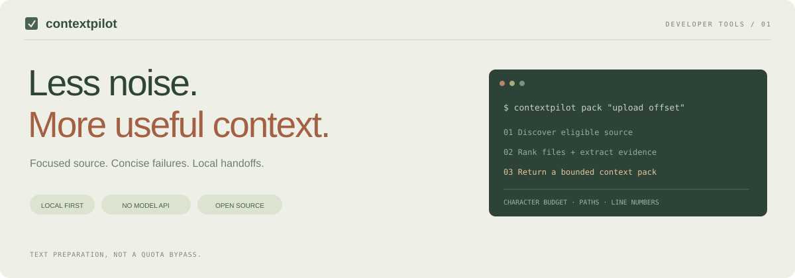
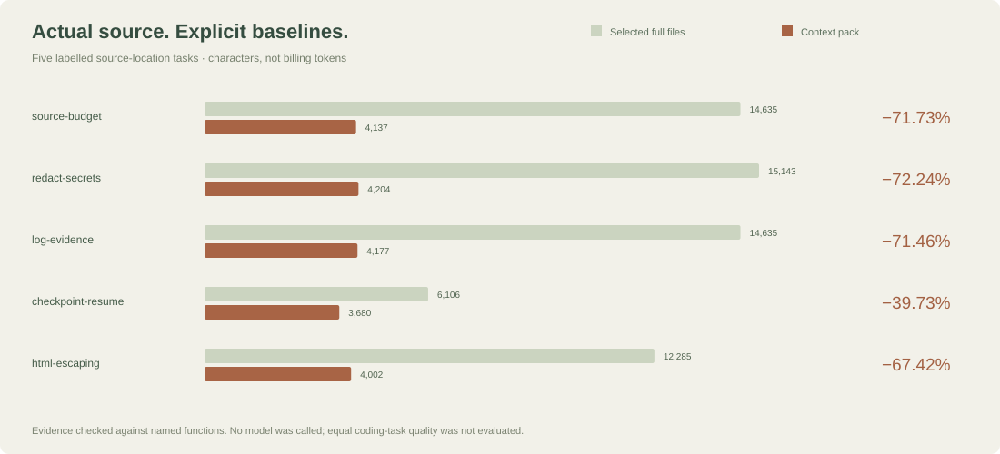

<p align="center"></p>

<p align="center"><b>Kodlama ajanları için yerel bağlam hazırlama aracı.</b><br>İlgili kodu seç. Hata kanıtını koru. Kaldığın yeri kısa bir notla kaydet.</p>
<p align="center"><a href="README.md">English</a> · <a href="docs/benchmarks.md">Ölçüm protokolü</a> · <a href="docs/architecture.md">Mimari</a></p>

## Neyi çözüyor?

Bir hatayı anlamak için bazen iki fonksiyon yeterlidir. Buna rağmen tüm dosyaların, tekrar eden test loglarının ve uzun sohbet geçmişlerinin okunması gerekebilir. ContextPilot, konuşmaya taşınacak metni **göreve odaklı ve sınırı belli bir pakete** dönüştürür.

Python CLI ve Codex'e kurulabilen bağımsız bir beceri içerir. Ücretli API, harici model, bulut hesabı veya telemetri kullanmaz. Codex'in beş saatlik yenilenme süresini değiştirmez; tüm mesajları otomatik sıkıştıran bir ağ eklentisi değildir.

## 0.2 sürümünde yeni

Bağımlılık ve test seçimi, isteğe bağlı gerçek tokenizer sayımı, aynı sohbete ait onaylı değişiklik paketleri ve karşılaştırmalı kanıt raporu eklendi. [Ayrıntılı kullanım ve sınırlar](docs/v0.2.md).

```powershell
python -m pip install ".[tokenizer]"
contextpilot pack "upload retry" --root . --with-dependencies --encoding o200k_base --max-tokens 2000 --max-chars 8000
```

Tokenizer ilk kullanımda encoding tablolarını indirebilir; kodunu uzak modele göndermez. Aktif Codex modelinin toplam token veya kota sayımı değildir.

## Özellikler

| Özellik | Davranış |
|---|---|
| İlgili dosya seçimi | Anahtar kelime, dosya yolu ve sembol eşleşmeleriyle puanlama |
| Bağlam paketi | Satır numarası ve SHA-256 etiketiyle bütçeli kaynak kesitleri |
| Hata özeti | Farklı hataları ve yakınındaki kanıtı korur; tekrarları kısaltır |
| Güncellik | Aynı boyutta ve aynı tarihte değiştirilmiş dosyayı bile içerik özetiyle fark eder |
| Proje hafızası | Görev, tamamlanan iş ve sonraki adımı yerel notta tutar |
| Değişiklik takibi | Açıkça alınmış anlık görüntüye göre eklenen / değişen / silinen dosyalar |
| Rapor | JSON ve internetsiz açılan HTML görünümü |
| Codex becerisi | Taşınabilir Python yardımcısıyla kurulabilir; mevcut kurulumu ezmez |

## Hızlı kurulum

Python 3.9 veya üstü gerekir. Git varsa ignore kuralları kullanılır; yoksa sınırlı dosya taraması yapılır.

```powershell
git clone https://github.com/berkayozdmr21/contextpilot.git
cd contextpilot
python -m venv .venv
.venv\Scripts\python.exe -m pip install .
.venv\Scripts\contextpilot.exe pack "upload offset sha256" --root "C:\Projects\Uygulamam" --max-chars 8000
```

Paket kurmadan denemek için:

```powershell
python skills/contextpilot/scripts/run.py pack "session expiry cookie" --root "C:\Projects\Uygulamam"
```

### Codex'e kur

```powershell
python scripts/install_skill.py
```

Beceri `$CODEX_HOME/skills/contextpilot`, bu değişken tanımlı değilse `~/.codex/skills/contextpilot` altına kurulur. Python kodu da bu klasöre kopyalanır; GitHub klonunu taşısan bile kurulu beceri çalışır. Var olan kurulum varsayılan olarak reddedilir. Güncelleme için `--update --backup ./skill-backup` kullanılır; yerel değişiklikler varsa üzerine yazılmaz.

Codex'te:

```text
$contextpilot Bu projedeki yükleme tekrar deneme hatası için ilgili bağlamı hazırla. UploadOffset ve sha256 sembollerini kullan.
```

Yeni beceri görünmezse Codex'i yeniden başlat. Genel beceri keşfi açıktır; her görevde zorla çalıştırılan bir kanca eklenmez. Kaynak kesitleri keşif içindir; düzenleme yapılmadan ilgili tam dosya okunmalıdır.

## Komut rehberi

```powershell
# Uygun kaynakların sayısı, tarama modu ve sınır bilgileri
contextpilot scan --root .

# İlk 20 ilgili dosya, puanları ve eşleşen terimler
contextpilot search "session expiry" --root .

# En fazla 5 dosyadan 8.000 karakterlik paket
contextpilot pack "session expiry cookie" --root . --max-chars 8000 --max-files 5

# Tek JSON içinde hem paket hem rapor
contextpilot pack "session expiry" --root . --json

# Orijinal dosyayı değiştirmeden hata özeti
contextpilot digest test-output.log --max-chars 4000

# Devir notu
contextpilot checkpoint --root . --task "Yükleme hatası" --done "SHA kontrolü doğrulandı" --next "İptal yarışını incele"
contextpilot recall --root .

# Dosya değişikliklerini takip et
contextpilot snapshot --root .
contextpilot changes --root .

# Son paketin raporu; var olan dosya üzerine yazılmaz
contextpilot report --root . --html rapor.html
```

Normal kullanımda kaynak metin stdout'a, ölçüm bilgisi stderr'a yazılır. `--json` kullanıldığında tek JSON döner. Paket karakter sınırı, ek açıklamaları da kapsar; ayrı JSON raporu bu sınıra dahil değildir.

## Testler ve ölçüm

65 davranış ve CLI testi bulunur. CI, Windows ve Linux üzerinde Python 3.9 / 3.12 / 3.13 ile çalışır. Sembolik bağlantı testleri, yerel Windows hesabında ayrıcalık yoksa atlanır; Linux'ta çalıştırılır.

Üç farklı kanıt seti vardır:

1. **Sentetik ShopCore:** 30 dosya, beş etiketlenmiş sorgu. Gerekli dosya ve fonksiyon işaretlerinin pakette bulunması kontrol edilir. Dolgu satırları içerdiği için yüksek küçülme oranı tipik proje sonucu değildir.
2. **Gerçek kaynak:** Bu projenin kendi Python kodundan beş fonksiyon bulma görevi. Üreteç ve belgeler tarama dışında tutulur. Sonuç, kod çözümünün doğruluğunu değil kaynak kanıtının seçilmesini ölçer.
3. **Gürültülü log:** 2.003 satır içinde hata, dosya konumu ve assertion korunuyor mu kontrol edilir.



```powershell
python scripts/benchmark.py --output examples/results
python scripts/real_benchmark.py
python -m unittest discover -s tests -v
```

Son test komutu için paketin kurulmuş olması gerekir. Kurmadan çalıştırıyorsan `$env:PYTHONPATH="$PWD/src"` tanımla. Ayrıntılı protokol: [benchmarks.md](docs/benchmarks.md). Ham çıktılar [examples/results](examples/results) içinde sürümlenir.

**Önemli ölçüm ayrımı:** Karakter azalması, gerçek model token'ı veya Codex kotası azalması değildir. Varsayılan token tahmini `ceil(UTF-8 bayt / 3)` sezgisidir; 0.2 sürümünde açık encoding ile düz metin için kesin sayım da seçilebilir. Akıl yürütme, ek araç çağrıları ve eksik bağlam nedeniyle gereken tekrarlar bu ölçümde bulunmaz. Sonuçları garanti edilmiş bir yüzdeye dönüştürmeyiz.

## Veri ve güvenlik

- Ağ isteği ve telemetri yoktur.
- `.env*`, anahtar dosyaları, yaygın gizli dosya adları ve üretilmiş klasörler varsayılan olarak dışlanır.
- `.contextpilotignore` ile basit glob kuralları eklenebilir. Bu dosya tam bir gitignore yorumlayıcısı değildir.
- Bilinen bazı anahtar / parola biçimleri maskelenir. Bu işlem gizli bilgilerin tamamını bulmayı garanti etmez.
- `.contextpilot/index.json`, maskelenmiş kaynak metni açık biçimde saklar. Klasörü paylaşma; şifreli kasa değildir.
- Proje metinleri, loglar ve notlar talimat olarak değil veri olarak değerlendirilmelidir.
- Araç kaynak dosyayı düzenlemez; yalnızca yerel durum klasörüne yazar. HTML raporu ise verdiğin yeni dosya yoluna yazılır.

Kaynak taraması en fazla 5.000 dosya, dosya başına 512 KB ve toplam 64 MB ile sınırlıdır. Log üst sınırı 16 MB'dir. Daha büyük depolarda daha dar bir kök seç. Teknik ayrıntılar [SECURITY.md](SECURITY.md) ve [mimari notlarında](docs/architecture.md).

## Lisans

MIT · [Berkay Özdemir](https://github.com/berkayozdmr21). OpenAI ile resmî bağlantı veya onay iddiası yoktur.
