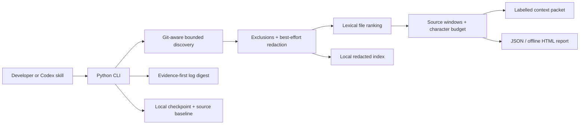

# Architecture and design decisions

## Local engine

Python's standard library is sufficient for traversal, subprocess-based Git discovery, hashing, ranking, serialization and command parsing. No embedding service, LLM call, database daemon or network dependency is needed at runtime. Packaging and optional coverage tooling are development concerns.

Discovery uses `git ls-files --cached --others --exclude-standard`. In a non-Git directory it falls back to a bounded walk. Built-in exclusions are applied in both modes. Symlinks and Windows reparse points are not intentionally followed. The tool is not a race-proof filesystem sandbox.

Source content is decoded as UTF-8, line endings normalized and known credential patterns redacted. Files over 512,000 bytes and binary-looking files are skipped. Total source bytes and eligible file count are capped. The report discloses a scan limit instead of pretending the entire repository was examined.

## Ranking and extraction

Identifiers are split at camelCase boundaries, Turkish diacritics are normalized and common stop words removed. File ranking uses a BM25-style frequency / length signal with a path-match bonus. It is intentionally lexical: no cross-language semantic equivalence or import graph is claimed.

For each file, line-level matches locate candidate windows. Matching declaration lines receive a bonus; nearby redundant centers are avoided. Windows can be offered out of file order, but retain original line numbers. A per-file share prevents one long file from monopolizing the pack. Warnings, query and labels count toward the final character ceiling.

Every pack is incomplete. Hashes identify the normalized, redacted indexed text rather than the raw binary source. Read a complete current file before editing it. A filename match can produce the beginning of a file even if there is no matching line inside it.

## Cache and changes

The index is a local inspectable JSON file, not an agent memory database. Every scan reads current eligible source and recomputes fingerprints; same-size / same-timestamp edits are detected. Previous cached text is never emitted instead of current source. `reusedFingerprints` reports matching fingerprints; it is not a count of avoided disk reads.

`snapshot` stores the current eligible-file fingerprint set. `changes` reports added, modified and deleted eligible files. A file becoming ignored appears deleted from the eligible set. No assumption is made that a model has already read unchanged files.

`checkpoint` stores one explicit task handoff, with bounded fields. It does not automatically summarize conversation history, execute the next step or overwrite AGENTS.md. Saved notes are data, not new authority.

## Log digest

The original log remains untouched. ANSI formatting is removed and common credentials are redacted. Error anchors and nearby lines are candidates; distinct anchors receive budget priority, duplicate lines are counted and selected evidence is output in original line order. An unrecognized error can be missed. No-error logs retain a small head / tail sample. Large distinct failures can exceed the budget; inspect the full original log as needed.

## Report and measurement

Character counts are exact Python string lengths after normalization / redaction, including packet labels. UTF-8 byte heuristics are labelled estimates. Neither is a billing-token counter. The selected-file and eligible-corpus baselines are separate, and negative savings are kept. No model execution or model correctness metric is silently inferred.

HTML uses escaped values, inline CSS and a restrictive CSP; it has no script, remote font, analytics or network request. The skill installer copies the complete helper into its own directory, refuses existing destinations and does not modify global Codex settings.

## Deliberate non-goals

There is no quota reset, request interception, account credential collection, automatic cloud sync, generated-code rewriting or hidden model routing. Semantic retrieval, dependency-graph expansion and real agent A/B trials are possible future work; they are not implemented features.
